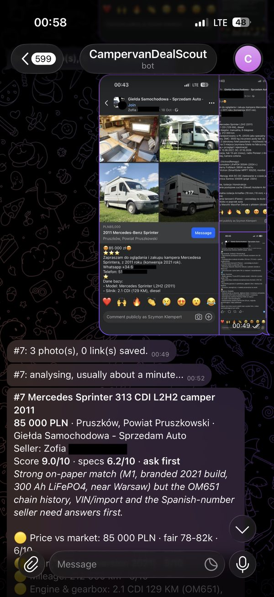
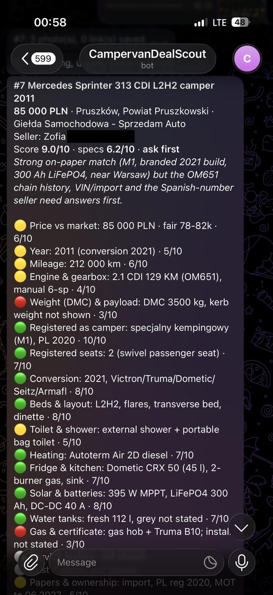

# deal-scout

A private Telegram assistant that reviews second-hand listings before you buy. You forward screenshots of a listing
from your phone. A few minutes later you get back a scored review, the questions the listing leaves open, and a
ready-to-send message for the seller. It runs on your Claude subscription through Claude Code, or on the Claude
API, OpenAI or OpenRouter.

What it reviews comes from a **domain**, a folder of plain files. The first domain, `domains/campervan/`, is for
buying a used campervan in Poland. A convertible or a TV would be another folder, with no code changes.

<table>
  <tr>
    <td></td>
    <td></td>
    <td></td>
  </tr>
  <tr>
    <td align="center">Forward the listing's screenshots</td>
    <td align="center">A scored summary, one line per spec</td>
    <td align="center">Red flags, then one tap for the seller message</td>
  </tr>
</table>

<sub>The real bot on a real listing; the seller's surname and phone numbers are hidden.</sub>

## What you get for each listing

```
#12 Mercedes Sprinter 313 CDI L2H2 2012
84 000 PLN · Kraków · Kampery na sprzedaż
Score 7.4/10 · specs 6.9/10 · ask first
Fits the budget and the must-haves, but there is no word on chain history or the registered seats.

🟢 Price vs market: 84 000 PLN · market ~86k (n=11) · 7/10
🟢 Engine & gearbox: OM651 129 KM, manual · 6/10
⚪ Registered seats: not shown
🟡 Solar & batteries: 200 W, AGM 2x95 Ah · 5/10
…one line per spec…

🚩 OM651 with no chain history · "4 miejsca" may mean sleeping places only
[💬 WhatsApp message]  [✉️ SMS]  [📨 Seller replied]  [📝 Feedback]  [📊 Open sheet]
```

- **Scores you can trust.** The model checks each of your criteria as met, missed or unknown, and scores each spec
  0–10 against a rubric you control. The final score is computed in code from those checks, so the same evidence
  always gives the same score. A missed deal breaker sets it to 0. Specs the listing doesn't show get no score, so
  they can't count against or for a listing.
- **What's missing, and the questions to close it.** Tap a button to get a polite first message in the seller's
  language, asking only what the listing leaves open. On WhatsApp it opens the chat with the text already typed; for
  SMS you get a version that copies with one tap.
- **The seller's answer, built in.** Tap 📨 Seller replied, then paste the seller's reply or send screenshots of it,
  and tap Re-analyse. You get an updated score, one line saying what changed and which questions were answered, and a
  short follow-up draft that asks only what is still open (or proposes a viewing).
- **Scores you can correct.** The 📝 Feedback button opens a menu that edits itself in place: pick a spec and the
  right score, or a criterion check and met, missed or unknown, and optionally reply with a reason. Your corrections
  are kept when the listing is analysed again, shown as ✏️ in the summary and the CSV, and logged for a later review
  of the rubric.
- **A listing card** (`listings/NNN.md`): facts with a certainty level, red flags, questions for the seller, and what
  to check on site.
- **A spreadsheet:** a CSV, plus an optional Google Sheet that every analysis updates.
- **Market prices from your own data:** `listings/market.md` gives the median asking prices of similar items you've
  collected, so "fair price" isn't a guess for long. Reposts count once, and price drops are tracked.

## Why not just ask Claude in a chat?

A chat is fine for one listing. Over dozens of listings and weeks of browsing, one long session degrades:
- the rubric gets diluted by everything that came after it;
- the model mentions what it happens to notice;
- scores drift from one listing to the next.

So the work is split, and the structure, not the model's memory, makes sure every part is covered:
- **Knowledge** (base vehicles, scoring bands, checklist, your criteria) is reloaded from files on every run.
- **The review** runs in a fresh context for each listing.
- **Coverage:** a strict schema requires an answer for every spec and every criterion, even if the answer is
  "unknown". Anything the model skips is recorded as "not shown".
- **The score** is computed in code from the criteria checks.
- **Market prices** come from code, built across all your listings.

The model does the judging, and code does the bookkeeping.

## How it works

```
phone ──screenshots──▶ Telegram bot ──▶ inbox/NNN/
                                          │  /done (or 3 min after the last photo)
                                          ▼
                     claude -p  (Claude Code, headless, no web, writes only to listings/)
                       reads: domains/<name>/  criteria · checklist · rubric files · card template
                              + the screenshots + listings/market.md
                       returns: JSON (specs, criteria checks, drafts) + writes the card
                                          ▼
               deal_scout/process.py: score in code ─▶ CSV · INDEX · market.md · Google Sheet
                                          ▼
                         Telegram: summary + buttons
```

- **Standard-library Python only.** The bot makes outgoing calls only (Telegram long polling), so no ports are
  open.
- **The model can't act on what it reads.** Claude Code runs with only the Read, Write, Edit and Glob tools,
  writes only to `listings/`, and has no shell or web access. The API providers get no tools at all and return JSON
  only. A listing is untrusted text from a stranger, so even a listing written to manipulate the model can't reach
  the network or anything outside the project.
- **Privacy:**
  - Seller phone numbers are never written to disk; they exist only inside a button. If a model puts one in a
    card anyway, it's removed.
  - Message contents are never logged.
  - `inbox/`, `listings/`, `logs/` and your `criteria.md` are git-ignored.
- **It never contacts anyone.** It prepares messages, and you send them.
- **Usage:**
  - every run's tokens and list-price cost go to `logs/usage.jsonl` (`/usage` shows the totals);
  - with `claude-code`, the analysis never receives an API key, so it always runs on the Claude subscription.

## Choosing the model provider

Set `PROVIDER` in `.env`:

| `PROVIDER` | Runs on | Needs |
|---|---|---|
| `claude-code` (default) | Claude Code, on your Claude subscription; no per-listing cost | Claude Code logged in |
| `anthropic` | Claude API, paid per use (default model `claude-opus-5-5`) | `ANTHROPIC_API_KEY`, `pip install anthropic` |
| `openai` | OpenAI API | `OPENAI_API_KEY`, `MODEL`, `pip install openai` |
| `openrouter` | any model on OpenRouter (Claude, GPT, Gemini, …) | `OPENROUTER_API_KEY`, `MODEL`, `pip install openai` |

**Claude Code:** reads the files and writes the card itself. It runs sandboxed: only the Read, Write, Edit and Glob
tools, write access only to `listings/`, and no web access.

**API providers:** one request per listing.
- **The request:** the instructions and the domain's files go in the system prompt, which is the same for every
  listing, so the provider can cache it. The photos, notes and market prices go in the user message.
- **The answer:** a strict JSON schema, including the card's text. Every provider returns the same structure, so
  scoring, the sheet and the Telegram output don't change.
- **Model choice:** for `openai` and `openrouter`, pick a model that accepts images and JSON-schema output.
- **Usage:** `/usage` counts tokens for every provider. Costs come from OpenRouter's own report or from
  `PRICE_PER_MTOK` in `.env`.

## Bot commands

| | |
|---|---|
| (send screenshots/links/notes) | saved as one listing; confirmed once with the count |
| `/done`, `/done 7` | analyse the open listing, or re-analyse #7 |
| `/phone 7 600 123 456` | add the seller's number to #7's WhatsApp message |
| `/list`, `/market`, `/sheet` | recent listings, market prices, open the Google Sheet |
| 📨 Seller replied (button under a summary) | send the seller's reply (text or screenshots) for that listing, then Re-analyse or `/done`; ends after 15 quiet minutes |
| 📝 Feedback (button under a summary) | correct a spec score or a criterion check, with an optional reason |
| `/status`, `/usage` | is the bot up to date and busy; how much Claude it used |

## Setup

1. `cp .env.example .env && chmod 600 .env`, then add a Telegram bot token from @BotFather.
2. Copy `domains/campervan/criteria.example.md` to `criteria.md` in the same folder and fill it in.
3. `python3 -m deal_scout` (from this folder), message the bot, and put the user ID it replies with into `.env`. From then on it only
   answers you.
4. Send a listing, then `/done`.

Optional extras:
- **Google Sheet:** `deploy/google-sheet.md`
- **Running on an always-on Linux box:** `deploy/README.md`
- **Adding a domain:** `domains/README.md`

Requirements: Python 3.10+. Then either [Claude Code](https://code.claude.com) logged in with a Claude subscription
(the default), or an API key and SDK for one of the other providers.

## Development

The rules for code changes are in [`docs/CODING_STANDARDS.md`](docs/CODING_STANDARDS.md). The bot needs only the
standard library; lint and type checks use two dev tools:

```sh
python3 -m venv .venv && .venv/bin/pip install -r requirements-dev.txt
.venv/bin/ruff check .                     # style, imports, docstrings, common bugs
.venv/bin/mypy                             # types (settings in pyproject.toml)
python3 -m unittest discover -s tests      # tests: no network, no model calls
```

CI (`.github/workflows/ci.yml`) runs all three on Python 3.10 and 3.12. Golden tests (`tests/test_golden.py`) freeze
every prompt, message and generated file, so a refactor can't change what the owner or the model sees unnoticed.

Code layout (the `deal_scout/` package, one job per module; run from this folder, no install needed):

| Module | Job |
|---|---|
| `bot.py` | the conversation: grouping messages into listings, commands, buttons, the analysis queue, the poll loop |
| `telegram.py`, `inbox.py` | the Telegram Bot API calls (HTTPS only), and the `inbox/NNN/` files |
| `__main__.py` | start-up wiring; `python3 -m deal_scout` starts the bot |
| `process.py` | one listing end to end; CLI `python3 -m deal_scout.process N` |
| `analysis.py`, `providers.py` | run Claude Code or one API request; same JSON schema for every provider |
| `prompts.py` | the prompt and the schema, built from the domain |
| `scoring.py` | the score from the criteria checks (pure functions) |
| `storage.py`, `market.py`, `sheet.py` | the CSV and INDEX, market prices (`python3 -m deal_scout.market`), the Google Sheet (`python3 -m deal_scout.sheet`) |
| `render.py`, `contact.py` | Telegram HTML; phone numbers and seller drafts |
| `replies.py` | the summary line about what the seller's reply changed (pure) |
| `corrections.py`, `feedback_menu.py`, `feedback.py` | the 📝 Feedback flow: applying a tap to the stored data, the menu screens, the overrides and their log |
| `config.py`, `domain.py`, `usage.py` | settings from `.env`, the active domain, usage records (`python3 -m deal_scout.usage` prints totals) |
