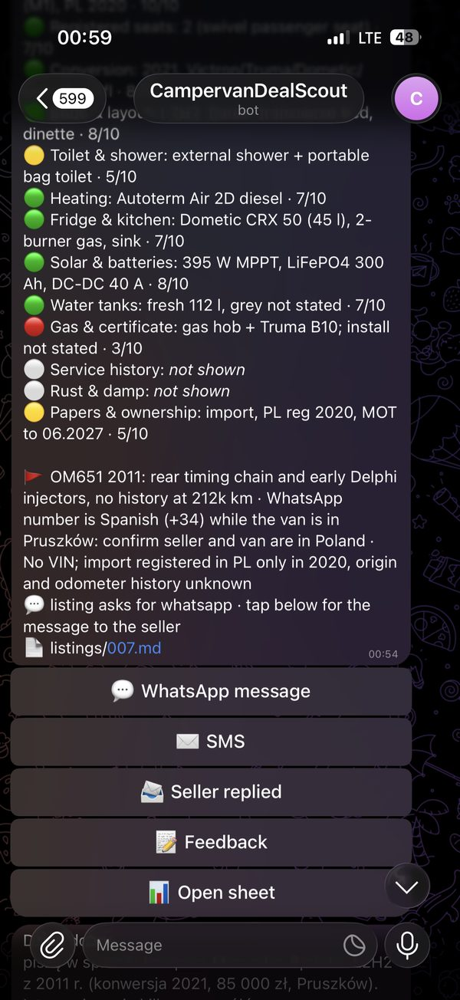

# deal-scout

[](https://github.com/szymonklempert/deal-scout/actions/workflows/ci.yml)   [](https://github.com/astral-sh/uv) [](https://github.com/astral-sh/ruff) [](https://mypy-lang.org/) [](LICENSE)

**Turns the chaos of second-hand listings scattered across marketplaces and groups (looking at you, Facebook) into
structured, scored, comparable data.**

Forward a listing's screenshots to a private Telegram bot and get back a scored review, the red flags, and a
ready-to-send message for the seller.

<table>
  <tr>
    <td></td>
    <td></td>
    <td></td>
  </tr>
  <tr>
    <td align="center">Forward the listing's screenshots</td>
    <td align="center">A scored summary, one line per spec</td>
    <td align="center">Red flags, then one tap for the seller message</td>
  </tr>
</table>

<sub>The real bot on a real listing; the seller's surname and phone numbers are hidden.</sub>

## What it does

- 📸 **Forward and forget.** Send screenshots, links or notes from your phone; everything sent together becomes one
  listing.
- 🧮 **Scored against your criteria.** Every spec gets 0–10 and the overall score is computed in code, so the same
  listing always gets the same score. A missed deal breaker sinks it.
- ❓ **Knows what's missing.** Gaps and red flags are listed, so you know what to ask before you drive anywhere.
- 💬 **Seller messages in one tap.** A polite message in the seller's language that asks only what's missing:
  WhatsApp opens with it typed in, the SMS version copies with a tap.
- 📨 **Follow-ups handled.** Forward the seller's reply: the listing is re-scored, answered questions drop out, and a
  follow-up (or a viewing request) is drafted.
- ☀️ **It speaks first.** A morning digest lists sellers still waiting on you, your top listings and market moves;
  a repost of an earlier listing is pointed out with its price change.
- 📊 **Everything organised.** Each listing lands in a Google Sheet (and a CSV) with its score, specs and your status,
  plus a card with all the facts.
- 📈 **Knowledge that keeps improving.** Market prices are recalculated from your own listings after every analysis.
  Correct a score with 📝 Feedback and it's logged; a review step turns repeated corrections into rubric updates you
  approve.
- 🔒 **Private and safe.** Only you can talk to it, phone numbers are never stored, and the model runs sandboxed with
  no web access. It never contacts anyone: you send the messages.
- 🧩 **Not just campervans.** What it reviews is a folder of plain files (`domains/campervan/`); a car or a TV is just
  another folder.

## How it works

1. The bot saves what you send into `inbox/NNN/`.
2. On `/done`, Claude Code (headless, sandboxed: no shell, no web, writes only to `listings/`) reads the screenshots,
   your criteria and the domain's knowledge files, and returns structured checks.
3. Code computes the score and updates the card, the sheet and the market prices; Telegram gets the summary with
   buttons.

Why not just a chat? Each listing gets a fresh context, the knowledge is reloaded every time, and a strict schema
forces an answer for every spec, so nothing is forgotten and scores don't drift.

It runs on your Claude subscription through Claude Code by default, or on the Claude API, OpenAI or OpenRouter
(`PROVIDER` in `.env`, see `.env.example`).

## Quick start

1. `cp .env.example .env && chmod 600 .env`, and add a bot token from @BotFather.
2. Copy `domains/campervan/criteria.example.md` to `criteria.md` and fill in what you're looking for.
3. `python3 -m deal_scout`, message the bot, and put the user ID it replies with into `.env`.
4. Send a listing, then `/done`.

Needs Python 3.12+ and [Claude Code](https://code.claude.com) logged in (or an API key). Optional:
[Google Sheet](deploy/google-sheet.md) · [always-on Linux box](deploy/README.md) · [new domain](domains/README.md).

## Commands

| | |
|---|---|
| send screenshots, links, notes | saved as one listing |
| `/done`, `/done 7` | analyse the listing, or re-analyse #7 |
| `/phone 7 600 123 456` | add the seller's number to #7's WhatsApp message |
| `/list`, `/market`, `/sheet` | recent listings, market prices, the Google Sheet |
| `/top`, `/compare 7 12`, `/show 7` | best open listings; side by side; one summary again (`/show_7` works too) |
| `/digest` | the morning digest now (it also arrives by itself at `DIGEST_TIME`) |
| `/status`, `/usage` | is the bot up to date; how much Claude it used |
| 📨 / 📝 buttons | add the seller's reply; correct a score |

## Development

```sh
make install   # dev tools (pinned in uv.lock) and the pre-commit hooks
make check     # ruff lint + format check, mypy, pytest; `make cov` adds a coverage report
```

Standard-library Python, one module per job in `deal_scout/`. CI runs the same checks on Python 3.12 and 3.14; golden
tests freeze every prompt and message. Pre-commit hooks format and lint on commit, and Dependabot keeps the actions
and dependencies current. Rules: [`docs/CODING_STANDARDS.md`](docs/CODING_STANDARDS.md).
